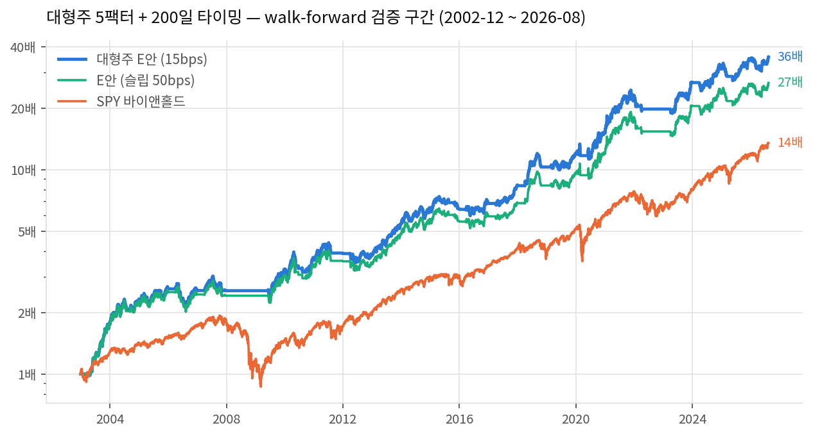

<div align="center">

<picture>
  <source media="(prefers-color-scheme: dark)" srcset="docs/images/brand/wordmark-dark.svg">
  
</picture>

# portfolio-research

**탐색 비용을 스스로 정산하는 미국 주식 팩터 연구 — 성과는 walk-forward만, 관문은 Deflated Sharpe와 PBO로 거르고 기각한 결과까지 함께 공개합니다.**

상장폐지 종목을 포함한 point-in-time 데이터 위에서 조용한 절단 없이 검증하고, 기각 기록까지 남깁니다.

[](https://github.com/younghwan91/portfolio-research/actions/workflows/ci.yml)
[](https://www.python.org/downloads/)
[](LICENSE)
[](https://www.linkedin.com/in/younghwan-chae/)

[가이드](docs/guide.ko.md) · [팩터 라이브러리](docs/factor-library.ko.md) · [연구 저널](docs/journal/README.ko.md) · [English](README.md)

</div>

<picture>
  <source media="(prefers-color-scheme: dark)" srcset="docs/images/performance-dark.png">
  
</picture>

<p align="center"><sub>세로축은 로그 스케일입니다 — 기울기가 같으면 수익률이 같습니다. 2008·2012·2022의 평평한 구간은 200일 이동평균이 현금으로 전환한 자리입니다.</sub></p>

## 빠른 시작

```bash
make install  # uv sync --extra dev — uv 필요 (https://docs.astral.sh/uv/)
make test     # pytest + coverage — 정상 설치 검증
```

저장소에 이미 커밋된 결과는 API 키나 벤더 데이터 없이 바로 확인할 수 있습니다.

```bash
# 전략 탐색 비용(DSR/PBO) 재현 — 벤더 데이터 없이 results/oos/만 읽음
uv run python scripts/strategy_search_cost.py

# VAA 원본 전략 — 무료 데이터(yfinance), 대화형 메뉴
make run
```

이 문서의 모든 수치는 2026-08-14까지의 데이터로 측정했으며 산출물은 [`results/`](results/)에 함께 커밋되어 있습니다. 팩터 엔진이나 TAA를 처음부터 다시 돌리려면 [Sharadar](https://sharadar.com) 구독이 필요합니다 — 자세한 명령은 [사용법](docs/guide.ko.md#사용법)을 참고하세요.

## 무엇이 들어 있나

세 개의 격리된 서브시스템이 서로 다른 질문에 답하고, 같은 과최적화 관문(Deflated Sharpe + PBO)으로 평가합니다. `taa/` → `factor.research.overfitting`을 제외하면 서로를 import하지 않습니다.

| | **팩터 엔진** (`factor/`) | **TAA 자산배분** (`taa/`) | **VAA 원본** (`strategies/`) |
|---|---|---|---|
| 질문 | 어떤 종목을 살까 | 어떤 자산군으로 갈아탈까 | (같음 — 첫 시도) |
| 대상 | 미국 개별주 (20,931종목, 1997~2026) | ETF 18종 | ETF 7~11종 |
| 데이터 | Sharadar 직판 (PIT · 상장폐지 포함) | Sharadar 펀드 벌크 (`closeadj`) | yfinance 일간 종가 |
| 진입점 | `opt-factor` · `opt-factor-tui` | `scripts/run_taa.py` | `make run` · `run.py` |
| 결과 | **채택 1건** (대형주 E안) | **채택 0건** — 9개 전부 PBO 관문 탈락 | 보존 — 왜 실패했는지의 기록 |

- **선언형 DSL 기반 팩터 158개.** 문헌 근거(Novy-Marx 2013, Sloan 1996, Ball et al. 2016, Chen & Zimmermann)가 있는 팩터만 담고 TTM·QoQ·YoY·가속 변형을 자동 생성합니다. 분류와 개수는 [`docs/factor-library.ko.md`](docs/factor-library.ko.md)에 있습니다.
- **전략당 JSON 한 파일.** 채택·기각·폐기한 전략과 운용 파라미터를 [`configs/`](configs/README.md)에 모두 공개합니다.
- **PIT 스토어.** `PITStore`(DuckDB)가 최초 공시 우선 원칙을 지키며 상장폐지 종목을 보존합니다.

## 성과

<!-- PERFORMANCE:START -->

*운용 후보 · walk-forward 검증 구간 · 2002-12 – 2026-08 (23.6년)*

**대형주 5팩터 + 200일 이평 타이밍** (`configs/strategy_lean_timed.json`)

| 지표 | 슬리피지 15bps | 슬리피지 50bps | SPY (같은 구간) |
|---|---|---|---|
| 연평균 수익률 | **16.34%** | 14.91% | 11.66% |
| 최대낙폭 | −24.3% | −24.3% | −55.2% |
| 변동성 | 15.7% | 15.7% | 18.6% |
| Sharpe | **0.727** | 0.648 | 0.418 |
| Calmar | **0.67** | 0.61 | 0.21 |
| Deflated Sharpe (파라미터 시도 72회) | **0.996** ✓ | 0.988 ✓ | — |
| Deflated Sharpe (**전략 탐색 35회**) | **0.982** ✓ | 0.957 ✓ | — |
| PBO (35개 구성 CSCV · 월별 · S=16) | **0.303** ✓ | — | — |

**방어 장치를 모두 켠 채로 측정했습니다** — 최소 주가 $5 · 최소 거래대금 $1M · 슬리피지. 유니버스가 역대 S&P500이라 용량 제약이 없습니다. 슬리피지를 50bps로 올려도 낙폭과 변동성은 그대로이고 수익만 1.4%p 줄어듭니다.

마지막 두 줄은 **walk-forward 바깥**을 정산한 값입니다("35개 전략을 훑어 하나를 골랐다"는 상위 탐색까지 시도 횟수에 반영). `uv run python scripts/strategy_search_cost.py`로 `results/oos/`만으로 재현할 수 있습니다.

<!-- PERFORMANCE:END -->

## 왜 이렇게 만들었나

퀀트 백테스트가 실패하는 전형적인 원인을 구조적으로 차단합니다. 원칙은 하나, **조용히 틀리지 않는 것**입니다.

| 흔한 실패 | 이 엔진의 대응 |
|---|---|
| **생존편향** | 상장폐지 종목 포함 (엔론·구 아메리칸항공 등 실제 확인) |
| **Look-ahead** | 표현식이 원시 테이블에 접근 못 하고 `PanelContext`가 `datekey` 정렬 강제 |
| **재공시 오염** | **최초 공시 우선** — 시장이 처음 본 값만 저장 |
| **조용한 절단** | 페이지네이션이 기대 범위 미달 시 `TruncatedDataError` 발생 |
| **과최적화** | **DSR**(Deflated Sharpe) + **PBO**로 시도 횟수 정산 |
| **인샘플 성과 보고** | 공식 성과는 **walk-forward**만 인정, 단일 백테스트는 참고용 명시 |

- **초소형주 표제 철회.** CAGR 23.78%를 기록하던 초소형주 8팩터 전략은 필수 방어 장치를 켜자 Sharpe `1.047 → −0.224`로 무너졌습니다. 자세한 경위는 [폐기한 것과 그 대가](docs/guide.ko.md#폐기한-것과-그-대가)를 참고하세요.
- **TAA 9개 사전등록, 9개 전부 기각.** ETF 18종 월간 로테이션은 관문을 통과하지 못했습니다(`PBO 0.770`). 상세 내용은 [전술적 자산배분](docs/guide.ko.md#전술적-자산배분--9개-사전등록-9개-기각)과 [`docs/taa/01-results.md`](docs/taa/01-results.md)에 있습니다.

## 한계와 가정

- **구간 내 큰 낙폭이 세 번뿐입니다** (2008·2020·2022) — 낙폭 방어 주장은 사건 세 개에 근거합니다.
- **거래비용은 측정이 아니라 가정입니다** — 15bps와 50bps를 모두 보고하지만 실제 보유 종목의 실현 스프레드는 측정하지 않았고, 세금도 반영하지 않았습니다.
- **팩터 집합 탐색은 정산되지 않았습니다** — 124개를 훑어 5개를 고른 과정에는 시도 횟수가 매겨지지 않았습니다. 전략 35개의 외부 탐색은 정산했습니다(`PBO 0.303 · DSR 0.982`).
- **숫자는 2026-08-14에서 멈춰 있습니다** — Sharadar 데이터 공급이 2026-09-14에 종료되어 라이브 `ingest`는 동작하지 않으며, 커밋된 `results/`만 재현할 수 있습니다.
- **TAA는 채택 건수가 0건입니다** — `strategies/`의 VAA 원본은 다른 데이터 소스에서 in-sample로 최적화한 결과이므로 비교 시 `taa/` 수치를 사용하세요.

> ⚠️ 모든 백테스트는 과거 데이터 기반이며 미래 수익을 보장하지 않습니다.

## 문서

| 문서 | 내용 |
|---|---|
| [프로젝트 가이드](docs/guide.ko.md) | 아키텍처, CLI 사용법, 개발 명령, 폐기된 초소형주·TAA 상세 |
| [팩터 라이브러리](docs/factor-library.ko.md) | 158개 팩터 카탈로그 및 문헌 근거 |
| [연구 저널](docs/journal/README.ko.md) | 기각된 20개 이상의 후보와 PBO 수정 기록 |
| [팩터 시스템 설계](docs/factor-system/) | 설계 명세, 데이터 계약, walk-forward 수식, 실험 로그 |
| [작업 규약](docs/rules.md) | 절대 규칙과 알려진 제약 전문 |

## 기여

- 버그 제보 및 질문: [GitHub Issues](https://github.com/younghwan91/portfolio-research/issues)
- 만든 사람: **채영환 (Younghwan Chae)** · [GitHub @younghwan91](https://github.com/younghwan91) · [LinkedIn](https://www.linkedin.com/in/younghwan-chae/)

## 라이선스

[MIT](LICENSE)
