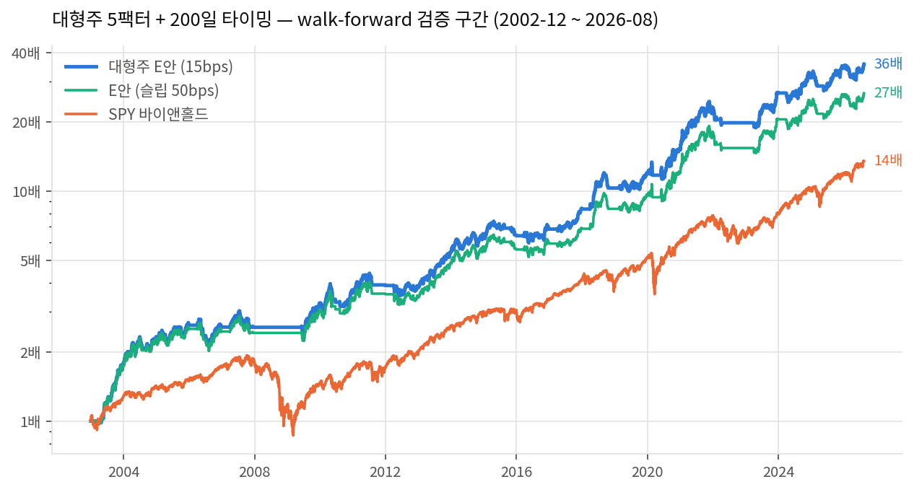

<div align="center">

<picture>
  <source media="(prefers-color-scheme: dark)" srcset="docs/images/brand/wordmark-dark.svg">
  
</picture>

# portfolio-research

**US equity factor research that charges for its own search — walk-forward only, Deflated Sharpe and PBO at the gate, and the rejections ship too.**

Point-in-time fundamentals with delisted names retained, zero silent truncation, and full rejection logs.

[](https://github.com/younghwan91/portfolio-research/actions/workflows/ci.yml)
[](https://www.python.org/downloads/)
[](LICENSE)
[](https://www.linkedin.com/in/younghwan-chae/)

[Docs](docs/guide.md) · [Factor Library](docs/factor-library.md) · [Journal](docs/journal/README.md) · [한국어](README.ko.md)

</div>

<picture>
  <source media="(prefers-color-scheme: dark)" srcset="docs/images/performance-dark.png">
  
</picture>

<p align="center"><sub>Log scale — equal slopes mean equal returns. The flat stretches in 2008, 2012, and 2022 are the 200-day overlay holding cash. (Chart labels are Korean; the alt text carries the reading.)</sub></p>

## Quick start

```bash
make install  # uv sync --extra dev — requires uv (https://docs.astral.sh/uv/)
make test     # pytest + coverage — sanity-check the install
```

Explore the checked-in results without any API key or vendor data:

```bash
# Reproduce the strategy-search cost (DSR/PBO) — reads only results/oos/
uv run python scripts/strategy_search_cost.py

# Original VAA strategy — free data (yfinance), interactive menu
make run
```

Everything reported here was measured on data through 2026-08-14 and ships in [`results/`](results/). Re-running the factor engine or TAA from scratch requires a [Sharadar](https://sharadar.com) subscription — see [Usage](docs/guide.md#usage).

## What is inside

Three isolated subsystems answer separate questions against the same overfitting gate (Deflated Sharpe + PBO). None imports another, except `taa/` → `factor.research.overfitting`.

| | **Factor engine** (`factor/`) | **TAA allocation** (`taa/`) | **Original VAA** (`strategies/`) |
|---|---|---|---|
| Question | Which stocks to buy | Which asset class to rotate into | (same — first attempt) |
| Scope | US single stocks (20,931 tickers, 1997–2026) | 18 ETFs | 7–11 ETFs |
| Data | Sharadar direct (point-in-time, delisted included) | Sharadar funds bulk (`closeadj`) | yfinance daily closes |
| Entry point | `opt-factor` · `opt-factor-tui` | `scripts/run_taa.py` | `make run` · `run.py` |
| Outcome | **1 adopted** (large-cap) | **0 adopted** — all 9 failed the PBO gate | Kept as the record of why it failed |

- **158 factors via declarative DSL.** Generates TTM / QoQ / YoY / acceleration variants from documented academic signals (Novy-Marx 2013, Sloan 1996, Ball et al. 2016, Chen & Zimmermann). See [`docs/factor-library.md`](docs/factor-library.md).
- **One JSON file per strategy.** Adopted, rejected, and retired configs — with operating parameters — live in [`configs/`](configs/README.md).
- **Point-in-time store.** `PITStore` (DuckDB) enforces first-print-wins fundamentals and retains delisted tickers.

## What it looks like when it works

<!-- PERFORMANCE:START -->

*Operating candidate · walk-forward validation window · 2002-12 – 2026-08 (23.6y)*

**Large-cap, 5 factors + 200-day moving-average timing overlay** (`configs/strategy_lean_timed.json`)

| Metric | Slippage 15bps | Slippage 50bps | SPY (same window) |
|---|---|---|---|
| CAGR | **16.34%** | 14.91% | 11.66% |
| Max drawdown | −24.3% | −24.3% | −55.2% |
| Volatility | 15.7% | 15.7% | 18.6% |
| Sharpe | **0.727** | 0.648 | 0.418 |
| Calmar | **0.67** | 0.61 | 0.21 |
| Deflated Sharpe (72 parameter trials) | **0.996** ✓ | 0.988 ✓ | — |
| Deflated Sharpe (**35 strategy trials**) | **0.982** ✓ | 0.957 ✓ | — |
| PBO (CSCV over 35 configs · monthly · S=16) | **0.303** ✓ | — | — |

**Measured with all guards switched on** — $5 minimum price, $1M minimum dollar volume, and slippage across the historical S&P 500 universe (no capacity limit). Raising slippage to 50bps leaves drawdown and volatility unchanged and costs 1.4pp of return.

The last two rows charge for the search **outside** the walk-forward ("35 strategies were tried and one was picked"). Reproduce with `uv run python scripts/strategy_search_cost.py` using only `results/oos/`.

<!-- PERFORMANCE:END -->

## Why it is built this way

Quant backtests fail in well-known ways. Each is blocked structurally under one principle: **never fail silently.**

| Common failure | How it is prevented |
|---|---|
| **Survivorship bias** | Delisted names retained (Enron, old American Airlines, Ambac verified present) |
| **Look-ahead** | Expressions cannot touch raw tables; `PanelContext` enforces `datekey` alignment |
| **Restatement contamination** | **First print wins** — only the number the market originally saw is stored |
| **Silent truncation** | Pagination raises `TruncatedDataError` when the expected range is not reached |
| **Overfitting** | **Deflated Sharpe Ratio** + **PBO** charge for the number of trials |
| **In-sample reporting** | Official performance is **walk-forward only**; single backtests are reference-only |

- **Micro-cap headline retracted.** An 8-factor micro-cap strategy (CAGR 23.78%) collapsed from Sharpe `1.047` to `−0.224` once mandatory guards were enabled. See [What was retired, and what it cost](docs/guide.md#what-was-retired-and-what-it-cost).
- **Nine TAA configs pre-registered, nine rejected.** Monthly rotation across 18 ETFs failed the gate (`PBO = 0.770`). See [Tactical asset allocation](docs/guide.md#tactical-asset-allocation--nine-pre-registered-nine-rejected) and [`docs/taa/01-results.md`](docs/taa/01-results.md).

## Limitations

- **Three major drawdowns only** (2008, 2020, 2022) — drawdown-defence claims rest on three events.
- **Assumed transaction costs** — 15bps and 50bps are both reported, but realized spreads of actual holdings were never measured. Taxes are not modelled.
- **Factor set screening is uncharged** — 124 factors were screened to reach the 5 in use; the outer search over 35 strategies *is* charged (`PBO 0.303`, `DSR 0.982`).
- **Data stops at 2026-08-14** — the Sharadar feed was discontinued on 2026-09-14, so live `ingest` no longer rebuilds the local store; checked-in `results/` remain reproducible.
- **No adopted TAA config** — `strategies/` (original VAA) is in-sample on yfinance; use `taa/` for fair comparison.

> ⚠️ All backtests are historical and do not guarantee future returns.

## Docs

| Doc | What's inside |
|---|---|
| [Project Guide](docs/guide.md) | Architecture diagram, CLI usage, dev commands, retired micro-cap & TAA details |
| [Factor Library](docs/factor-library.md) | 158-factor catalog and academic rationales |
| [Research Journal](docs/journal/README.md) | Full trail of 20+ rejected candidates and PBO fixes |
| [Factor System Specs](docs/factor-system/) | Design specs, data contract, walk-forward math, experiment log (Korean) |
| [Rules & Constraints](docs/rules.md) | Absolute rules and known constraints (Korean) |

## Contributing

- Bug reports and questions: [GitHub Issues](https://github.com/younghwan91/portfolio-research/issues)
- Author: **Younghwan Chae (채영환)** · [GitHub @younghwan91](https://github.com/younghwan91) · [LinkedIn](https://www.linkedin.com/in/younghwan-chae/)

## License

[MIT](LICENSE)
