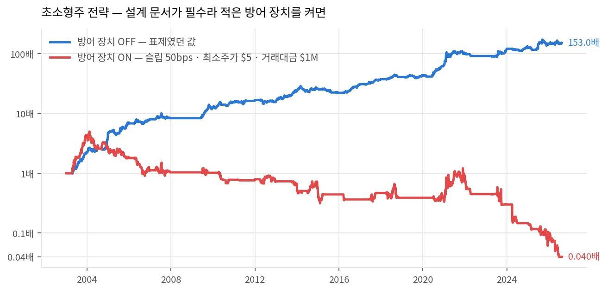
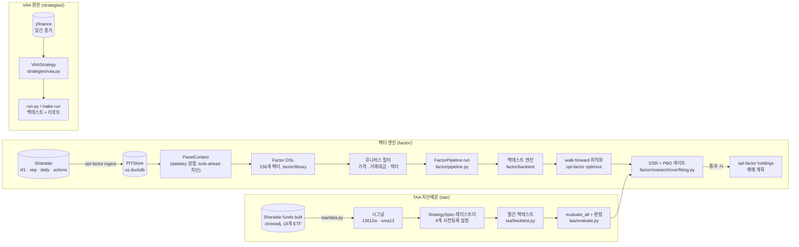

# 프로젝트 가이드

처음 방문하셨다면 [README](../README.ko.md)부터 읽어 보세요 · [English](guide.md).

<!-- toc -->
- [기각 이력](#기각-이력)
- [아키텍처](#아키텍처)
- [사용법](#사용법)
- [개발](#개발)
<!-- /toc -->

## 기각 이력

### 폐기한 것과 그 대가

<picture>
  <source media="(prefers-color-scheme: dark)" srcset="images/guards-dark.png">
  
</picture>

*같은 전략, 같은 구간. 차이는 슬리피지·최소 주가·최소 거래대금뿐이다. 파란 선이
2026-08-16 까지 이 README 의 표제였다.*

CAGR 23.78% 의 **초소형주 8팩터 전략**이 이 자리에 있었다. 설계 문서가 필수라고
적은 방어 장치 셋을 켜자 무너졌다 — **Sharpe 1.047 → −0.224.** 방어를 켜면
유니버스의 98% 가 사라지기 때문이다. 표제는 대형주 전략으로 옮겼다. 그쪽은 처음부터
방어를 켠 채로 쟀고, 그래서 두 전략을 같은 조건에서 비교한 적이 없었다.

DSR 관문에서 기각한 후보가 스무 개를 넘고, PBO 는 제대로 재기 전까지 두 번 틀린 채로
발표됐다. **그 자취를 전부 남겼다 —** [`docs/journal/`](journal/README.ko.md).

### 전술적 자산배분 — 9개 사전등록, 9개 기각

개별 종목 대신 ETF 18종을 매월 교체한다. **9개 구성을 사전등록했고 9개 전부
기각했다 — PBO 0.770.** 관문을 완화하지 않았다.

아무것도 안 통한다는 뜻은 아니다. BAA(Keller 2022) 변형 6개는 예외 없이 Calmar 에서
60/40 을 이긴다(0.535~0.812 대 0.354). 다만 그 6개만으로 잰 PBO 가 0.861 이라
**그중 어느 것이 최선인지는 이 데이터로 정할 수 없다.** 두 문장은 함께 서야 한다.

9개 구성과 이 과정에서 잡은 결함 8건, VAA 가 논문의 16~17% 대신 여기서 6.07% 로
측정된 이유는 [`docs/taa/01-results.md`](taa/01-results.md) 와
[`docs/journal/`](journal/README.ko.md) 에 있다.

## 아키텍처



## 사용법

> 아래 적재·최적화 명령을 다시 돌리려면 [Sharadar](https://sharadar.com) 구독이
> 필요하다. PIT 재무제표와 폐지 종목 커버리지를 함께 주는 유일한 소매 가격 소스다.
> 어댑터는 중립적인 `Provider` 프로토콜 뒤에 격리돼 있어 소스 교체는 파일 하나를
> 다시 쓰는 일이다.

```bash
# 데이터 적재 (Sharadar 구독 필요)
export SHARADAR_API_KEY=...
opt-factor ingest --store us.duckdb --provider sharadar \
  --tables sf1,sep,daily,actions,sp500,tickers

# 팩터 예측력 검증 — 10분할 · IC · 회전율
uv run python scripts/factor_lab.py --store us.duckdb --factors GP_A,PER,SIZE

# 공식 성과 (walk-forward + DSR)
opt-factor optimize --store us.duckdb --config configs/strategy_lean_timed.json \
  --space configs/space.json --objective calmar

# 오늘 살 종목 (현재 보유를 주면 매매 계획까지)
opt-factor holdings --store us.duckdb \
  --config configs/strategy_lean_timed.json --current my_holdings.csv

# TAA: 9개 구성 · PBO · 판정표
uv run python scripts/run_taa.py
```

## 개발

```bash
make lint           # ruff check + format --check
make typecheck      # mypy src/
```

패키지 관리는 **uv**(`uv.lock`)다. `pip install` 하지 않는다. 코드는
`src/opt_portfolio/` 아래 `factor/`·`taa/`·`strategies/` 로 나뉘고 `analysis/`·`core/`
를 공유한다.
