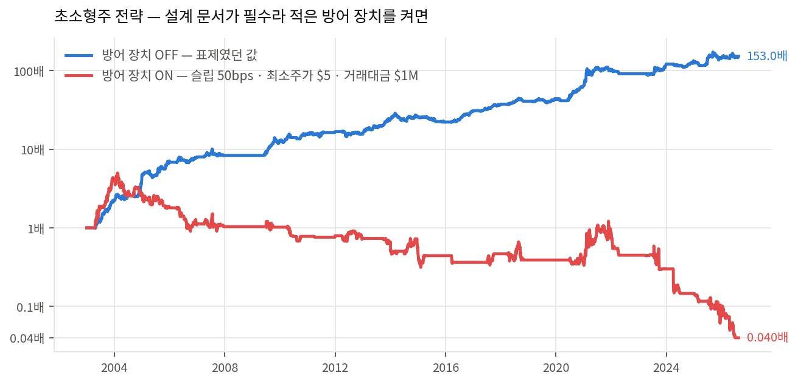
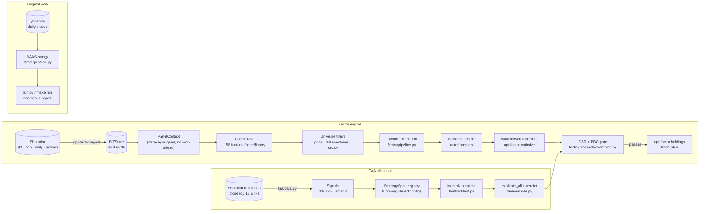

# Project Guide

New here? Start with the [README](../README.md) · [한국어](guide.ko.md).

<!-- toc -->
- [Rejection history](#rejection-history)
- [Architecture](#architecture)
- [Usage](#usage)
- [Develop](#develop)
<!-- /toc -->

## Rejection history

### What was retired, and what it cost

<picture>
  <source media="(prefers-color-scheme: dark)" srcset="images/guards-dark.png">
  
</picture>

*Same strategy, same window; the only difference is slippage, minimum price and
minimum dollar volume. The blue line was this README's headline until 2026-08-16.*

A **micro-cap, 8-factor strategy** at CAGR 23.78% stood here until the three guards
the design document calls mandatory were switched on. They collapse it — **Sharpe
1.047 → −0.224** — because 98% of the universe disappears with them on. The headline
moved to the large-cap strategy, which had always been measured with its guards on and
so had never been compared on equal terms.

Over twenty candidates were rejected at the Deflated Sharpe gate, and the PBO number
was published wrong twice before it was measured properly. **The whole trail is
written down:** [`docs/journal/`](journal/README.md).

### Tactical asset allocation — nine pre-registered, nine rejected

Monthly rotation across 18 ETFs. **Nine pre-registered configurations, all nine
rejected: PBO = 0.770.** The gate was not relaxed.

That does not mean nothing works. All six BAA variants (Keller 2022) beat 60/40 on
Calmar without exception, 0.535–0.812 against 0.354 — but PBO across just those six is
0.861, so **which one is best cannot be determined from this data.** Both sentences
have to stand together.

The nine configurations, the eight defects caught along the way, and why VAA measured
6.07% here against the papers' 16–17% are in
[`docs/taa/01-results.md`](taa/01-results.md) (Korean) and
[`docs/journal/`](journal/README.md).

## Architecture



## Usage

> Reproducing the ingest/optimize commands below needs a
> [Sharadar](https://sharadar.com) subscription — the only retail-priced source with
> point-in-time fundamentals *and* delisted coverage. The adapter sits behind a neutral
> `Provider` protocol, so swapping sources means rewriting one file.

```bash
# Ingest data (Sharadar subscription required)
export SHARADAR_API_KEY=...
opt-factor ingest --store us.duckdb --provider sharadar \
  --tables sf1,sep,daily,actions,sp500,tickers

# Screen factor predictive power — decile spread, IC, turnover
uv run python scripts/factor_lab.py --store us.duckdb --factors GP_A,PER,SIZE

# Official performance (walk-forward + Deflated Sharpe)
opt-factor optimize --store us.duckdb --config configs/strategy_lean_timed.json \
  --space configs/space.json --objective calmar

# What to buy today (pass current holdings to get a trade plan)
opt-factor holdings --store us.duckdb \
  --config configs/strategy_lean_timed.json --current my_holdings.csv

# TAA: 9 configurations · PBO · verdict table
uv run python scripts/run_taa.py
```

## Develop

```bash
make lint       # ruff check + format --check
make typecheck  # mypy src/
```

Dependencies are managed with **uv** (`uv.lock`). Do not use `pip install`. Code lives
in `src/opt_portfolio/`: `factor/`, `taa/`, `strategies/`, with `analysis/` and
`core/` shared.
